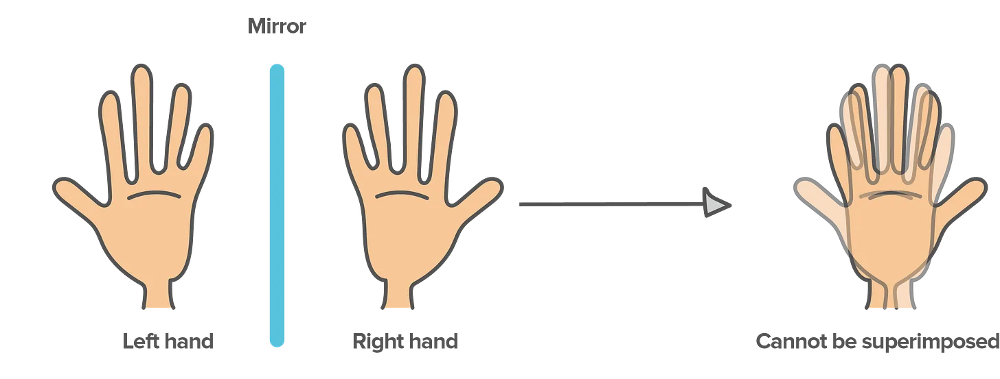
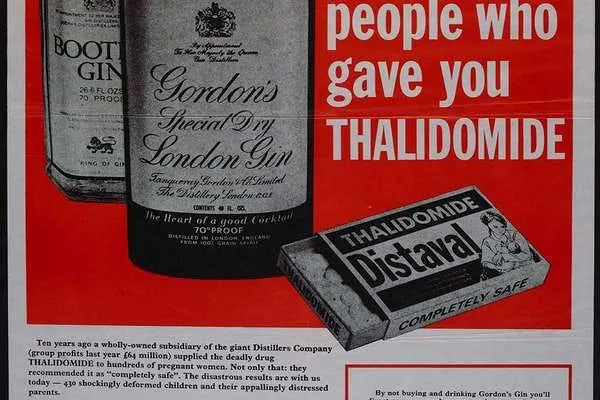
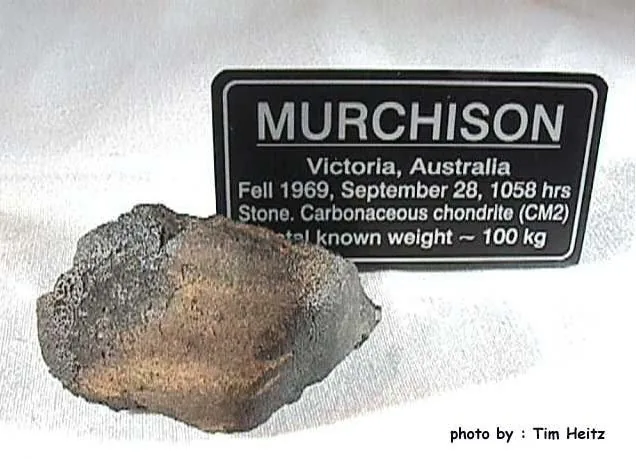


<h2 id="but-what-is-chirality">But what is chirality? </h2>
Hold up your two hands. Now put your left hand on the table and on top of it, put your right right hand (superimpose). They look identical, same fingers, same shape but they don&#8217;t line up right? 

That&#8217;s chirality. An object is <strong>chiral</strong> if its mirror images cannot be superimposed.
<figure><figcaption>Credit: Khan Academy</figcaption></figure>
A molecule is chiral when its central atom is bonded to four different groups of atoms arranged asymmetrically in three-dimensional space. This creates two distinct mirror-image forms, called <strong>enantiomers </strong>which can&#8217;t be superimposed. 

Enantiomers have identical physical properties in most neutral settings. Same melting point, same weight, same solubility. But put them in a biological environment, and they behave completely differently. Building blocks like enzymes, amino acids, sugars all are chiral.

Chemists use a simple notation: <strong>L (levo)</strong> and <strong>D (dextro)</strong>, from the Latin for left and right. When <strong>plane polarized light</strong>, light whose waves oscillate in a single plane &#8212; is passed through a solution of a chiral molecule, the molecule rotates that plane either clockwise or counterclockwise.
<h2 id="homochirality-and-why-it-matters">Homochirality and why it matters?</h2>
Every protein in your body is built from <strong>L-amino acids. </strong>All of them, without any exception. The 20 standard amino acids that your ribosomes assemble into proteins,  every single one is L-configured.

Every strand of DNA uses <strong>D-deoxyribose</strong> as its sugar backbone. Every molecule of RNA uses <strong>D-ribose</strong>. Again, universally, without exception.
<pre class="prose"><mark style="background-color: rgb(217, 234, 211); color: rgb(0, 0, 0);">"Every organism that has ever been studied uses L-amino acids and D-sugars, across 3.8 billion years of life on Earth, with no exceptions ever found."</mark></pre>
This matter because mixing chiralities would be catastrophic. If even a small fraction of D-amino acids were part of a protein, the chain would fold incorrectly. A misfolded protein cannot function. Life as we know it could neither emerge nor persist in a <strong>racemic world</strong> (one with a 50-50 mix of both forms).
<h2 id="the-cost-of-chirality">The cost of chirality</h2>
In the late 1950s and 1960s, the drug <strong>thalidomide</strong> was prescribed to pregnant women to treat morning sickness. It worked, but the drug had two enantiomers. One was therapeutic. The other caused devastating birth defects, affecting thousands of children worldwide. Same molecular formula, same atoms, same bonds but different optical rotation. 
<figure><figcaption><strong>Catalogue reference from the nationalarchives.gov.uk</strong></figcaption></figure><h2 id="but-why-life-favoured-one-side">But why life favoured one side?</h2>
Amino acids are always levorotatory(L) and sugars are always dextorotatory(D). But why? Unfortunately, no one knows the answer to this question. In a pre-biological world, heat, light, pressure, simple chemistry, are all symmetric. There is no reason why L-alanine should form more readily than D-alanine.

The famous <strong>Miller-Urey experiment (1952</strong>), simulation of early Earth's atmosphere that produced amino acids from gases and lightning and you get equal amounts of both enantiomers. <strong>A perfect 50-50 racemic mixture.</strong>
<h2 id="and-there-are-theories">And there are theories</h2>
<h3 id="theory-1-the-frozen-accident"><strong>Theory 1: The frozen accident</strong></h3>
First proposed by Francis Crick, this theory argues pure chance. Early self-replicating molecules happened to incorporate a slight excess of L-amino acids. Once begun, the process was self-reinforcing: L-molecules replicated more efficiently alongside other L-molecules, driving the system toward homochirality. 

It is the simplest explanation and that&#8217;s why for many researchers, exactly what makes it unsatisfying.

<h3 id="theory-2-it-came-from-space"><strong>Theory 2: It came from space</strong></h3>
In 1969, a meteorite fell near Murchison, Australia. Scientists found amino acids inside with a <strong>slight excess of the L-form</strong> and isotopic analysis confirmed an <strong>extraterrestrial origin</strong>. 

This raised a stunning possibility: what if the chiral bias didn&#8217;t start on Earth at all? The leading mechanism is circularly polarized light from neutron stars, which preferentially destroys one enantiomer over billions of years that eventually rained down onto early Earth.
<figure></figure>
<h3 id="theory-3-magnetic-lakes-on-early-earth"><strong>Theory 3: Magnetic lakes on early Earth</strong></h3>
Researchers proposed (PMID: <a href="https://pubmed.ncbi.nlm.nih.gov/35787048/">35787048</a>) that UV irradiation of <strong>magnetite deposits in shallow prebiotic lakes</strong> could generate spin-polarized electrons capable of inducing chirally, a phenomenon called the <strong>CISS effect (Chiral-Induced Spin Selectivity)</strong>. 

In laboratory experiments using magnetite surfaces, scientists achieved an enantiomeric excess of around 60% in an RNA precursor which was previously not found and quitely validate the theory.

A 2025 paper in <em>PNAS (</em>PMID: <a href="https://pubmed.ncbi.nlm.nih.gov/40828029/">40828029</a>) argued that previous work focused too narrowly on single molecules or single mechanisms. The new model proposes that <strong>homochirality emerged from an interconnected prebiotic chemical network</strong>, many reactions reinforcing each other, amplifying a small initial asymmetry into the universal bias we observe today
<h2 id="the-question-is-still-open-ended">The question is still open ended. </h2>
If life evolved independently on another planet, it might use <strong>D-amino acids and L-sugars</strong>, the mirror image of everything on Earth. Its proteins would fold in opposite directions. Its DNA would spiral the other way. <strong>So similar, yet so different.</strong>

This makes chirality one of the most powerful <strong>biosignatures</strong> we could search for across the cosmos. Not just as evidence of life, but as evidence of <strong>whether that life shares our origin or arose independently.</strong>

<em><strong>&#8220;Life, as manifested to us, is a function of the asymmetry of the universe.&#8221;</strong></em>

<em><strong>                                                                                          -Louis Pasteur, 1874                                 </strong></em>


